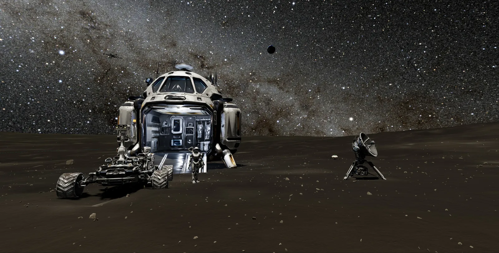
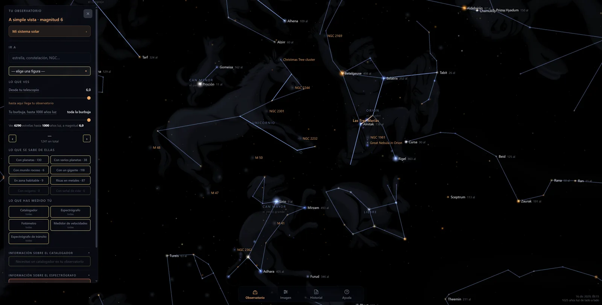
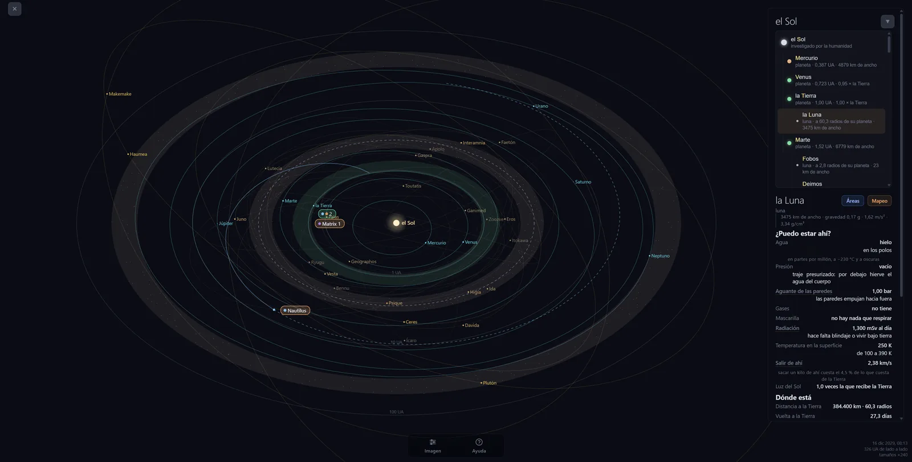
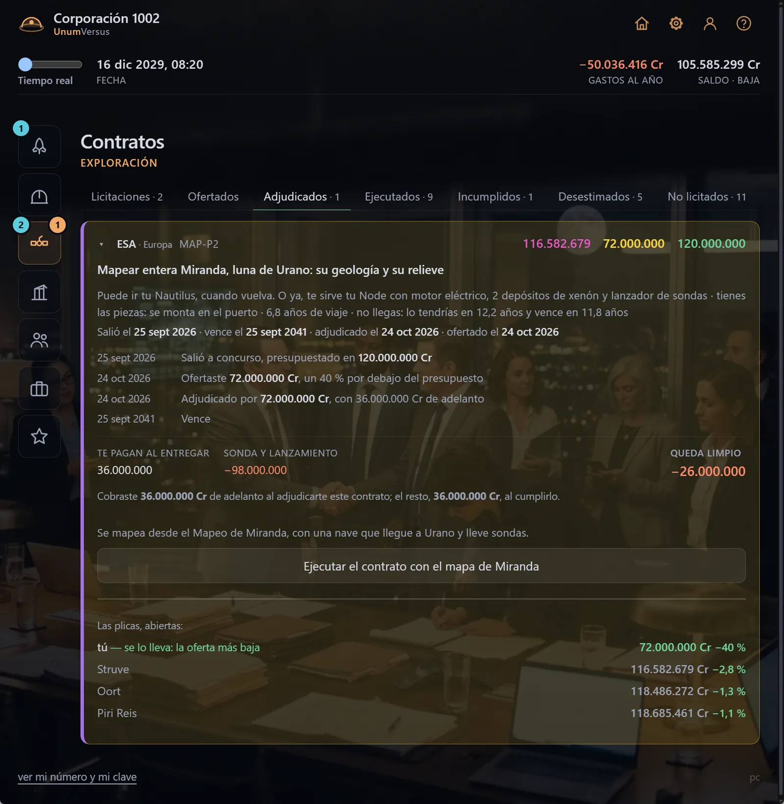
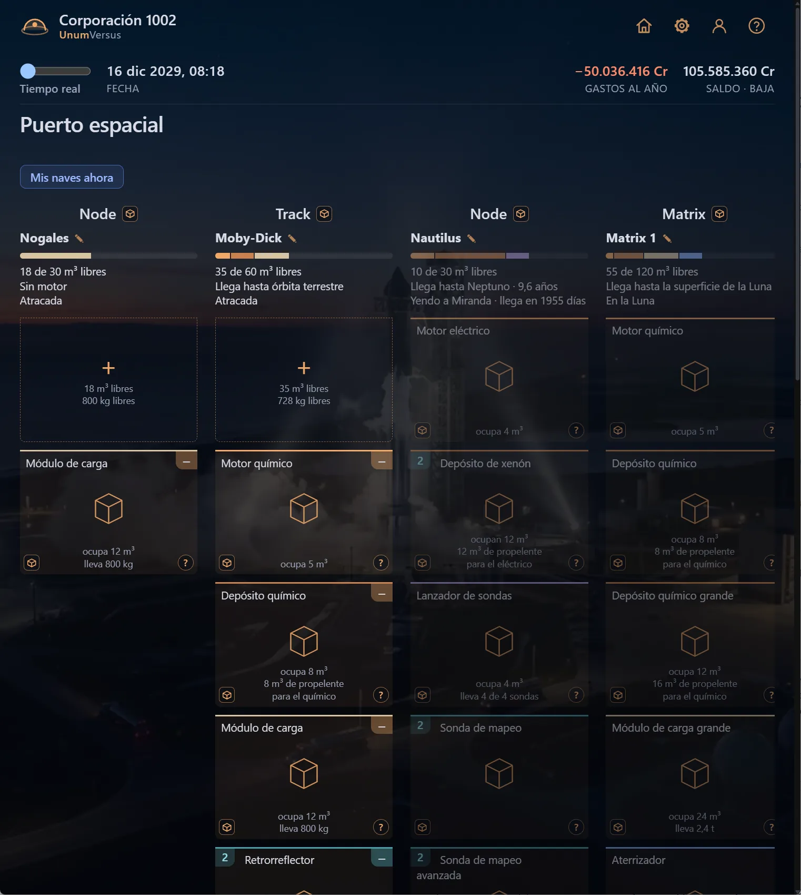

**English** · [Español](README.es.md)

# UnumVersus

**A game about running a space company inside the real Milky Way.** Eight
million real stars from Gaia DR3, the planets where they actually are today,
and materials that actually exist — and then you land on the real Moon and
go to work on it. No war, no victory screen — just the gap between what a kilo
costs down here and what it is worth up there.

https://github.com/user-attachments/assets/de156010-54b3-485a-8aee-d7d9b7a57acf

*The real Moon, photographed by NASA down to two metres. Your lander, your rover,
your robot, a seismometer listening — and the Milky Way overhead.*

| | |
|:--:|:--:|
|  |  |
| **Eight million stars, measured one by one by Gaia.** Every one of them is really there. | **The Solar System, where it actually is today.** Go outside and check it. |
|  |  |
| **Real tenders.** Bid too high and someone else takes it; too low and you win it and lose money. | **You design the ship, module by module.** And the first time, you land it yourself. |

*Every picture here is a screenshot of the game as it runs today, cursor and all.
The game is in Spanish for now; it is being built to speak 25 languages.*

## What you do in it

- **Point real instruments at real stars.** Five of them, each answering one
  question, the way real observatories work: a photometer that catches the dip a
  planet leaves as it crosses its star, a velocity meter that weighs it, a
  transit spectrograph that reads what its air is made of.
- **Search the ground for what is buried in it.** Drive a scanner across
  prospecting zones and find out what minerals are there, where the ice is — and
  whether any of it is worth mining.
- **Listen to any planet or moon.** Set up seismometers, magnetometers,
  heat-flow probes and laser reflectors, as Apollo did. Three seismometers far
  enough apart hear the meteorites hit, and tell you where.
- **Build a base**, module by module, with your rover, your robot and your drone.

It all starts on the Moon, which is already playable — the rest of the Solar
System comes after.

## Start here

**→ [THE_GAME.md](THE_GAME.md) — the whole game in two minutes.**

It also says, at the end and on purpose, exactly what is built and what is not.

## What this repository is

A window, not the source. The code lives in a private repository; what is here
is the design — so that people can read how the thing is meant to work, argue
with it, and suggest what it is missing.

**What I am looking for is ideas, not patches.** The game is a long way from
finished and the interesting problems are design problems, not coding ones.

**→ Head for [Discussions](../../discussions).** That is where it happens, in
English or in Spanish.

## Who is doing this

One person, [@PedroMacia](https://github.com/PedroMacia), building it in the
open-ish. It has been going since August 2026.

---

© 2026 Pedro. All rights reserved. The text in this repository is published so
that it can be read and discussed, not reused.
