# UnumVersus — the game in two minutes

**Today you were made CEO of a company that puts satellites into orbit.**

Today, literally: the date you press *Play* is day one of your company, and from
then on its calendar is yours.

It isn't a big company. One customer who pays for twelve launches a year, one
small ship, one warehouse, one telescope and a team that can build whatever you
ask for. That covers the bills, with little to spare.

Your job is to make it into something more.

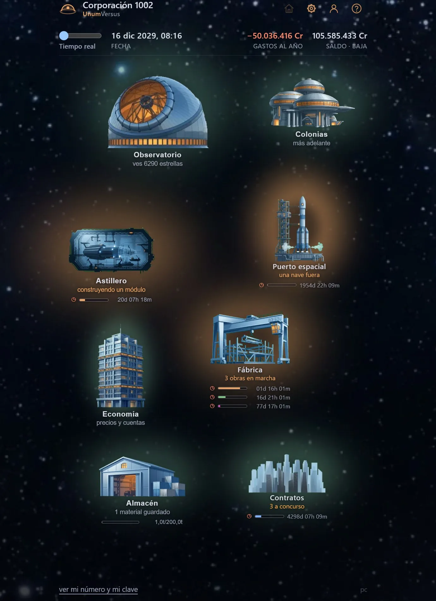

*Your company on day one: observatory, shipyard, spaceport, factory, economy,
warehouse, contracts. Colonies, later.*

## None of what you will see is made up

You are in the Milky Way — the usual one, ours. The stars are the ones actually
out there: eight million of them, measured one by one by a real space telescope.
The planets are where they really are today; you can walk outside and check it.
The Moon under your wheels is the one NASA and Japan have photographed down to
two metres. And the materials you will be selling exist: water, platinum,
helium-3. Not one of them is fiction.

You start out knowing what humanity knows, which is a great deal. Everything
beyond that, you will have to find out yourself.

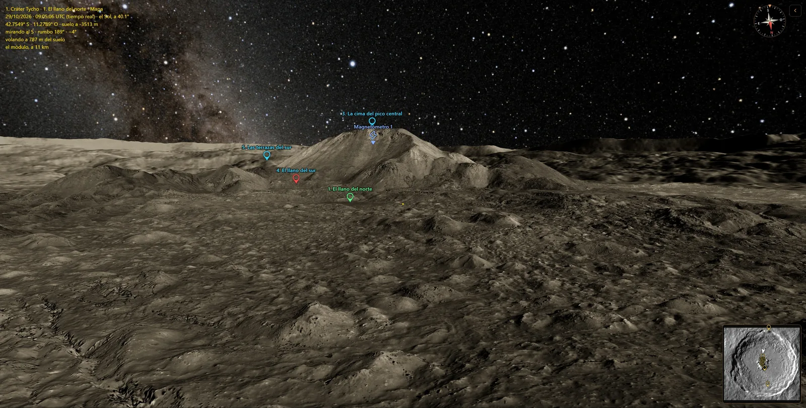

*The central peak of the crater Tycho, from the real relief and the real photos.*

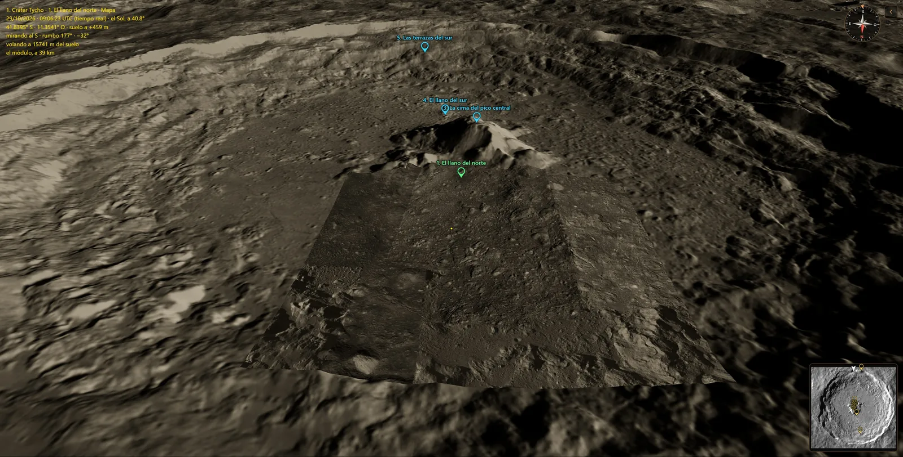

*The same crater from 15 km up. The sharp square is NASA's two-metre mosaic; around
it, the rest of the Moon at lower resolution.*

## The whole business fits into a single number

Putting one kilo from Earth down on the surface of the Moon costs around
**330,000 euros** — that is what NASA is paying today. A kilo of water, down
here, is worth nothing.

That gulf between the two prices is your entire business. Anything you manage to
make up there — water, oxygen, fuel, girders — instead of lifting it from down
here, is money. And anything you bring back has to be worth a lot per kilo for
the trip to pay for itself.

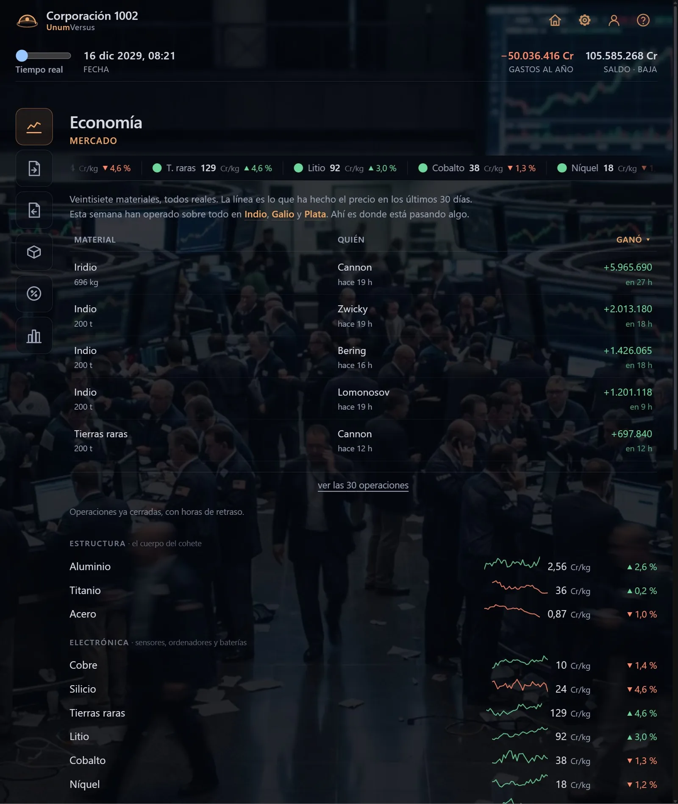

*Twenty-seven real materials, prices that move, and the other companies trading.*

## And there are customers waiting

NASA, Europe, China, Japan, India and Russia are all heading for the Moon in the
next few years, and none of them wants to pay that price per kilo. So they put
out tenders, and they pay whoever solves it for them: carry this to orbit, land
that on the surface, set up these instruments, bring back those rocks, find
where the ice is.

You bid. Too expensive and somebody else takes it; too cheap and you win it and
lose money. And forty other companies are bidding against you.

*Mapping Miranda, a moon of Uranus, for the European Space Agency. The bids are
opened at the end: you took it 40 % under budget.*

## Then you go down there

A contract is not a line in a spreadsheet. You design the ship that will fly it,
module by module. You fly it to the Moon. And the first time, you land it
yourself.

Down there you are standing on the real ground: real craters, real slopes, the
Sun and the Earth where they really are in the sky. You drive a rover, you send a robot to dig,
to set up a seismometer, to pick up a sample. You scan the ground for what is
buried in it. And if it is worth it, you build a base, one module at a time.

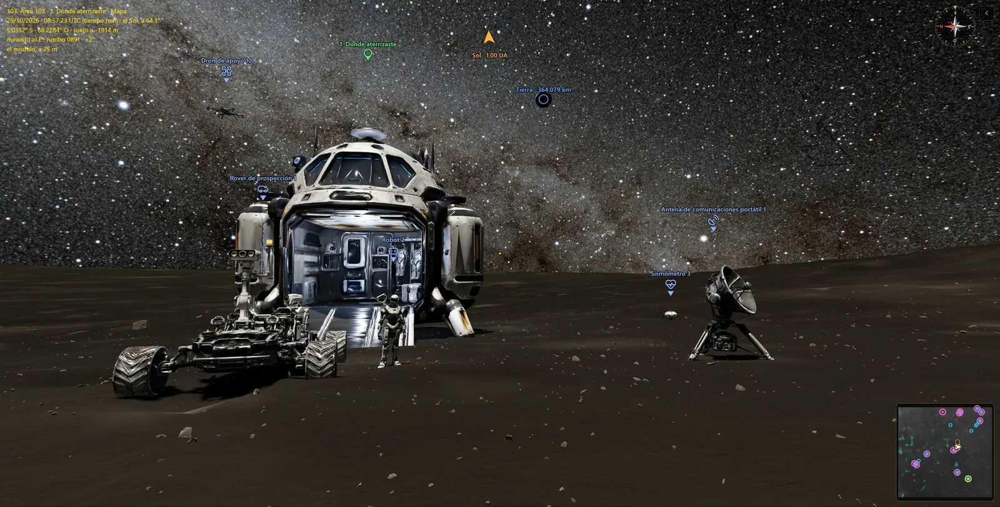

*Everything has a name and a place: the lander, the rover, the robot, the drone,
the antenna, the seismometer. And the Earth, 364,079 km away.*

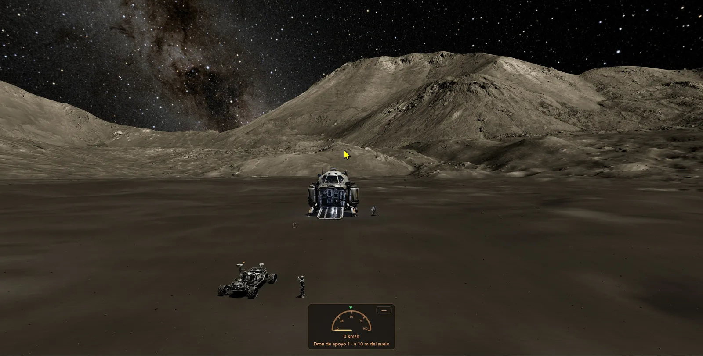

*The same kind of site seen from the support drone.*

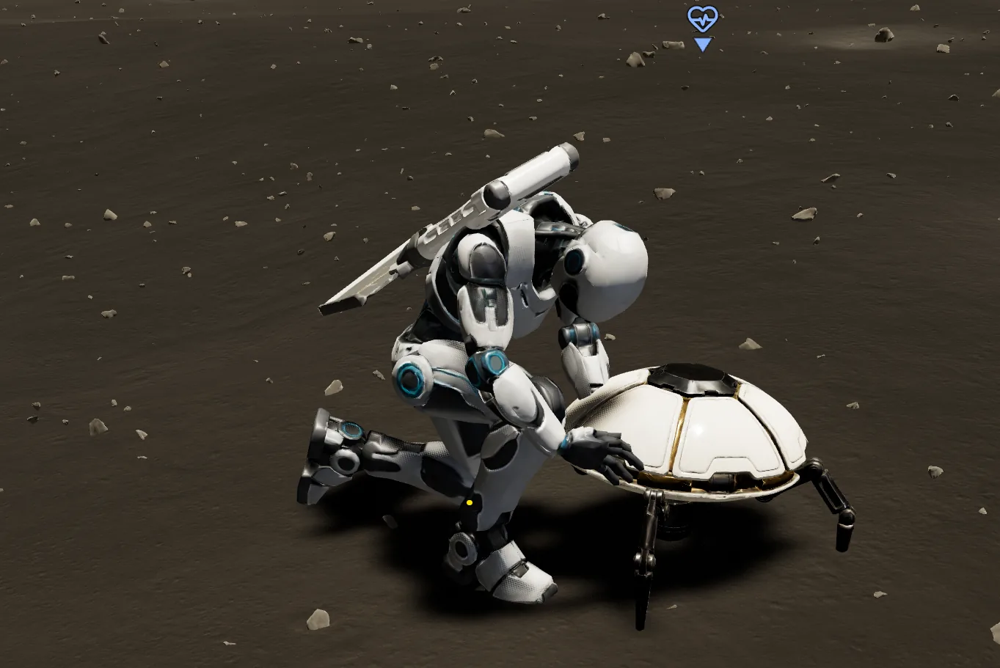 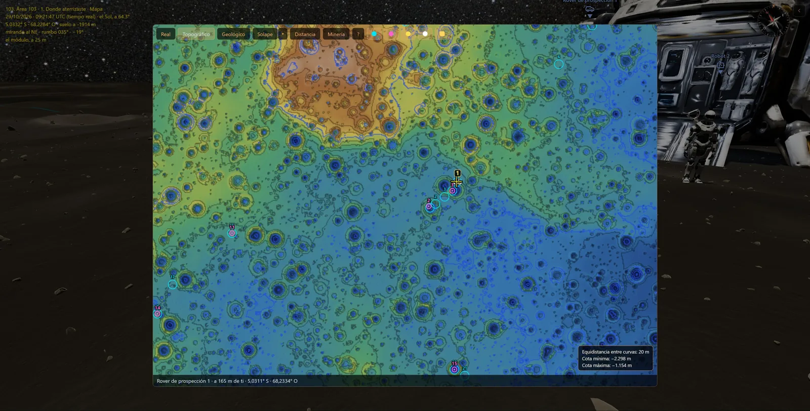

*The robot switching on a seismometer, and the relief map of the area with the
zones the rover has scanned.*

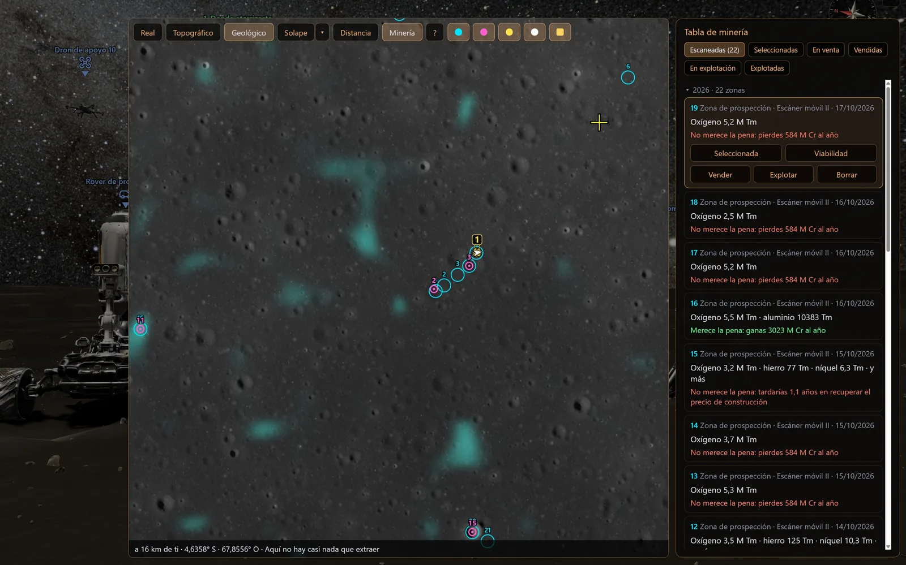

*What the scanner found, zone by zone, and whether it is worth mining: most of the
time it is not.*

## The clock runs, and you are the one running it

You can leave the clock in real time to buy, sell and think things over. Or
speed it up — **up to ten game years for every real day** — while you wait for
a ship to arrive or a build to finish.

**There is no pause key.** Real time is the pause.

And time costs money: while it runs, your bills run with it. Speeding up is
putting your foot down knowing that you are burning fuel.

## There is no war, and there is no winning

Nobody is going to attack you. No armies, no weapons, and no victory screen:
this does not end.

**But you can lose.** If you are slow, if you commit to what you cannot deliver,
or if you leave the clock running while the bills eat you alive, one day you
will open it and the company will be gone.

## You are alone — and maybe not forever

This Milky Way is yours, and so is its Moon. You will never run into anybody
inside it: the only thing you share with the other players in the world is the
price of things.

But a long, long time from now, when somebody builds an engine that can leave
this galaxy and reach another, they might find someone there. **Nobody has made
it yet**, and what happens on the day somebody does has not been decided.

## Year 1 of your company begins when you close this page.

---

# What actually exists today

Kept separate on purpose, so that nobody confuses the game we want with the game
that is built. As of 29 October 2026.

### The sky

| | |
|---|---|
| 8,361,977 real stars from Gaia, each with its data sheet, plus search and constellations | ✅ |
| An observatory with five instruments, each answering one question (what is it, does it have planets, what is its air made of…) | ✅ |
| What humanity already knows: the planets found so far, and the atmospheres measured by Hubble and Webb | ✅ |
| Your telescope only shows what it can reach; better telescopes, more sky | ✅ |

### The Solar System

| | |
|---|---|
| Every planet and moon at its real position today | ✅ |
| The globe of each body: photo, relief and minerals, from the real missions | ✅ 31 bodies |
| Mapping the moons nobody has seen up close, with probes | ✅ the first mission is still on its way |

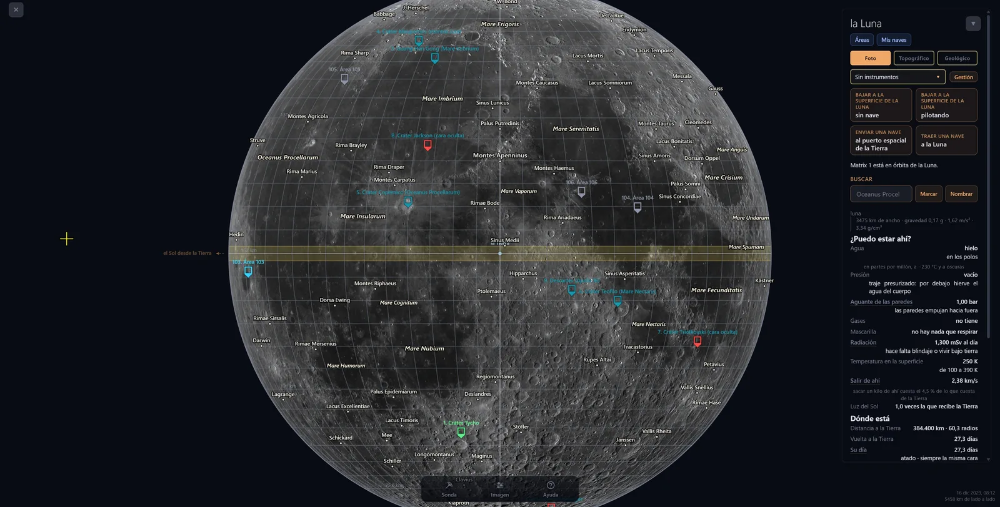 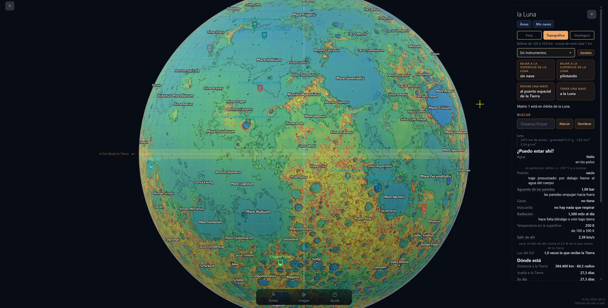 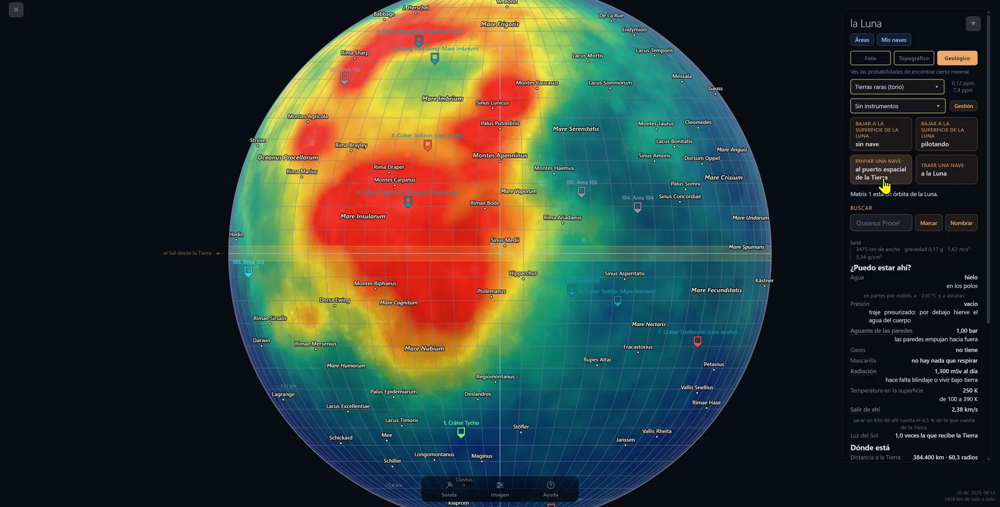

*The globe of the Moon: the photo, the relief, and where the thorium is, from Lunar Prospector.*

### The company

| | |
|---|---|
| The clock as something you drive, and that brakes by itself when something needs you | ✅ |
| A market of 27 materials and 40 rival companies | ✅ |
| Invoices, taxes, an advance of half the price when you win a contract | ✅ |
| A bank that lends against what you are owed | ✅ |
| Stock: what you bought, where it is, what was lost on the way | ✅ |

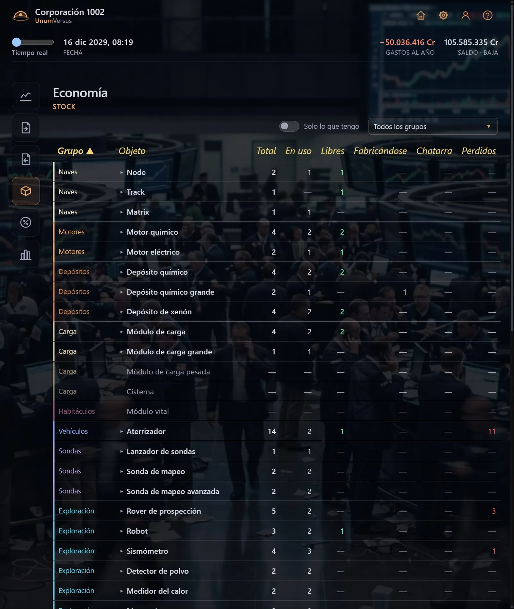

### Contracts

| | |
|---|---|
| Real tenders: you bid against the others and see every bid when it closes | ✅ |
| Carry cargo to Earth orbit, lunar orbit or the lunar surface | ✅ |
| Observe for a client | ✅ |
| Find sites on the Moon with enough of a given material | ✅ |
| Find water ice in the polar craters | ✅ |
| Set up instruments (seismometers, laser reflectors) and collect samples | ✅ |
| Build a base for a client | ✏️ designed |
| Colonies | ✏️ designed |

### Ships

| | |
|---|---|
| A shipyard: three hulls and the modules you put in them (engine, tanks, cargo, lander, probes) | ✅ |
| A spaceport, and a list of your ships with the history of each one | ✅ |
| A tech tree of everything that can be built, and what each thing needs | ✅ |

 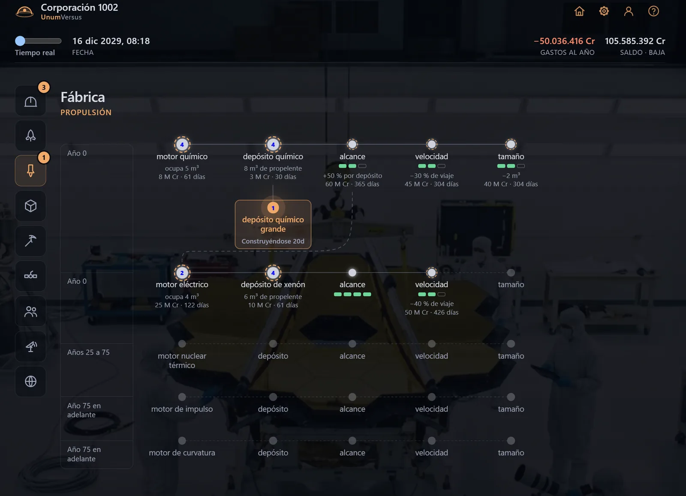

### On the surface of the Moon (PC only)

| | |
|---|---|
| Landing your ship yourself | ✅ |
| Nine public areas to walk: two with the real ground at 2 m, seven generated from laws measured on NASA data | ✅ |
| Your own areas, anywhere on the Moon | ✅ |
| A rover you drive, a robot that digs, drives and works, a drone | ✅ |
| Scanning the ground for what is buried in it, ice included, and a viability study | ✅ |
| Building a base, module by module | ✅ |
| A seismic network that hears the meteorites hitting the Moon and locates them | ✅ |
| Mining and selling what you mine | ✏️ designed |
| Mars | ❌ not yet |

### What is not there at all yet

Tourism, nuclear and faster engines, other galaxies, and meeting other players.
